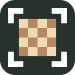
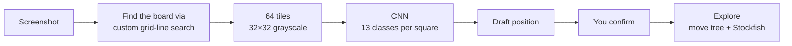
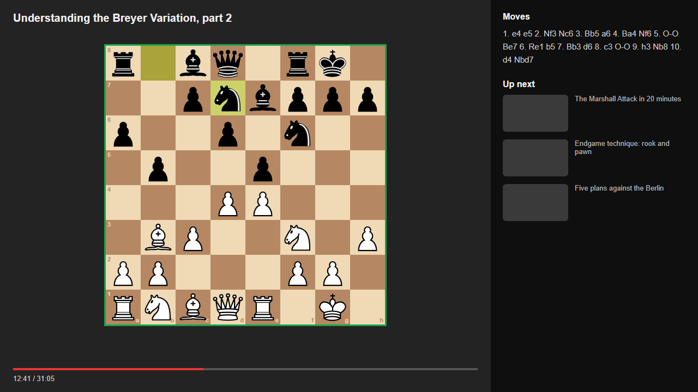
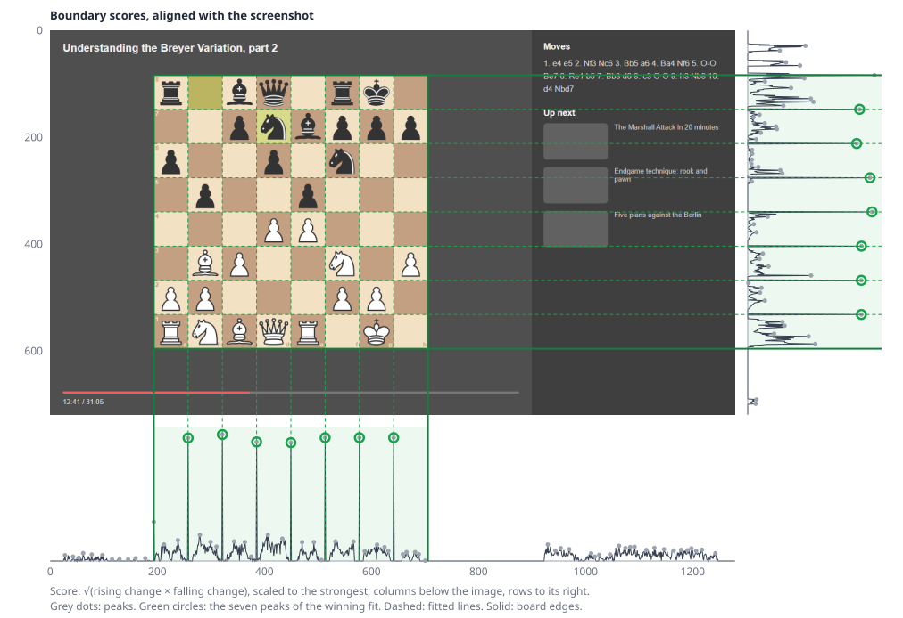
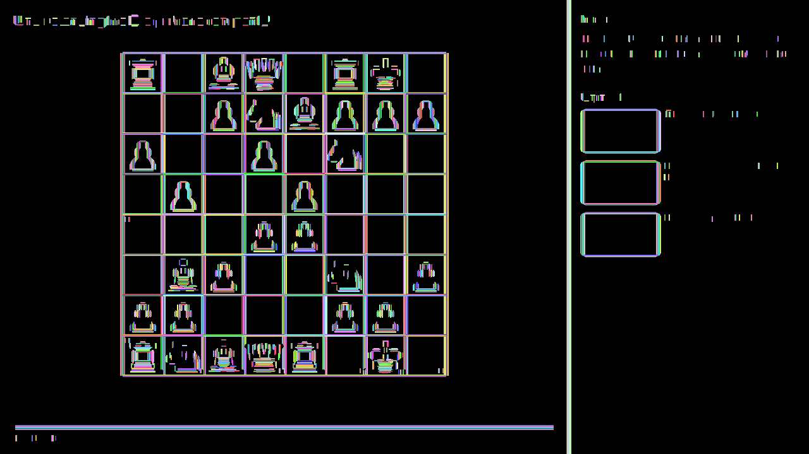
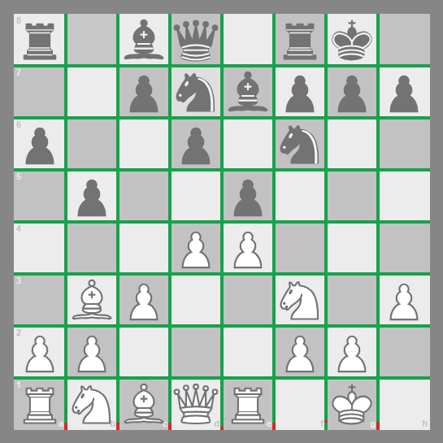
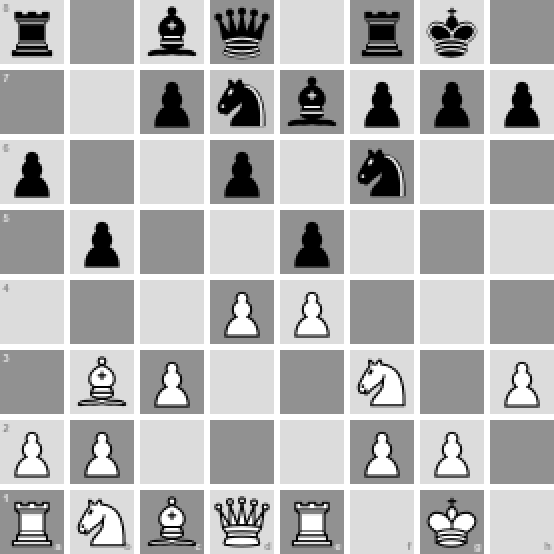
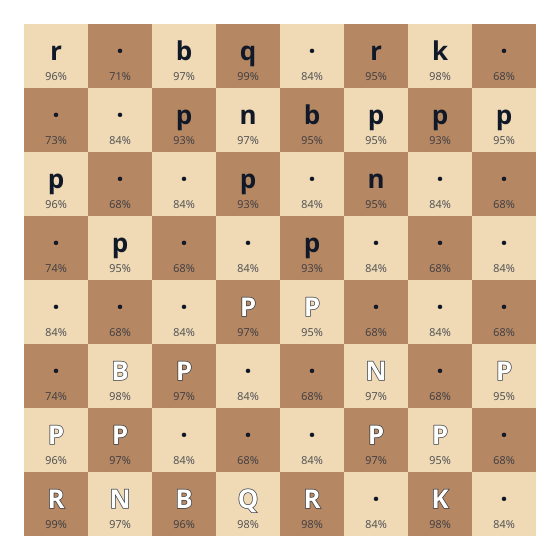

# Chess Video Position Explorer

A Chrome extension for learning chess by experimenting. Screenshot any chess board on
your screen (a video, a website, an article), and explore the position yourself. Try
your own moves, branch into as many variations as you like, and play them out by hand or
against Stockfish. It's a lightweight side panel and runs entirely locally in the
browser.

This README explains what we built and why, and then how it works, in particular the
two computer-vision steps that turn a screenshot into a position: **finding the board**
and **reading the pieces**.

## Why we made this

You're watching a game and wonder why the player chose that move, or why the move you
had in mind wouldn't work. To find out, you'd normally set the position up on an analysis
board and play it out yourself or against an engine. But setting it up piece by piece takes
time, and over a long video or article that time adds up. Skip it, though, and you never
get to test the idea, so the same assumptions and questions keep coming back.

We wanted to make that take seconds, and then keep track of every variation you branch
into from there, so exploring also isn't limited to a single line.

## What this extension does

1. **Capture.** Click **Capture tab** in the side panel, and the extension takes a
   screenshot of the visible tab.
2. **Find the board.** The board is automatically located and outlined. If there's more than one, crop
   around the one you want.
3. **Read the pieces.** A small neural network reads each square, and the position is
   loaded into an editor for you to confirm.
4. **Explore.** Play moves and branch freely. Play both sides yourself, or start and stop playing against
   Stockfish at any point. Stockfish analyses every position and compares your move with its own choice.

## How it works

All the figures below come from one screenshot made for this README: a mock video
page, rendered in headless Chrome, with a sample position drawn with the extension's
own piece set. The extension's own code then ran on it. The figures are generated by
[`extension/scripts/figures.ts`](extension/scripts/figures.ts)

_The test screenshot, with the board the locator found outlined in green. x = 194, y = 84, 512 × 512._

### 1. Finding the board

The board could be anywhere on the screenshot and any size, next to other things with
straight edges: video frames, text, thumbnails. The locator doesn't use machine learning,
by choice, because boards have repetitive, structured features that we can take advantage
of. That saved us from needing thousands of labelled training images, and it finds
the board's edges exactly to the pixel with efficient use of memory and computation.

The locator looks for the one thing every board has, an **8 × 8 grid of equally-sized squares**,
which alternate between **light** and **dark**. Grayscale makes it independent of the board's colour.

Our final locator is a TypeScript port of a prototype we wrote out in Python first, where we designed
the following algorithm.

**Step 1: score every boundary between neighbouring columns and rows.** A screenshot is a grid of pixels.
Where two squares of a board meet, neighbouring pixels jump from light to dark or dark to light, so the
difference in brightness between them is large. A single jump doesn't mean much (text and icons make them
too). But take the boundary between two neighbouring columns of pixels, and compare the two pixels on
either side of it in each row. Where the boundary runs along a board line, the two pixels are on different
squares in every row the board spans, so the difference is large hundreds of times over. Horizontal
lines work the same way, comparing pixels above and below.

For the boundary between columns _i_ and _i_ + 1, we add up how much the brightness _rises_ across it (grayscale
increases), over every row, and separately how much it _falls_ (grayscale decreases). The score is the product of
the two sums. We do a similar procedure between all rows _i_ and _i_ + 1.

Taking the product between the two sums is the trick. An ordinary edge, like
the side of a video frame, only goes one way (dark to light, say), so one of the two sums
is near zero and so is the score. A line between two files of a chessboard goes light-to-dark
on half its squares and dark-to-light on the other half, so both sums are large and so is the product.

_The boundary scores, aligned with the screenshot: columns below, rows to the right. Each circled spike lines up with one of the board's interior lines. The noise under the sidebar comes from its text._

**Step 2: find seven evenly spaced peaks.** The peaks of the score (grey dots) are the
candidate lines. The locator looks for the board's **seven interior lines** rather than
its outer edges, because the edges are often weak or missing (say, a board on a
background of similar colour). It tries every pair of peaks as the first and seventh
line, predicts where the five lines between them should be, and keeps the fit only if a
real peak lies close to each prediction and the seven peaks are within 2 px of a
straight-line fit.

Here, that leaves 12 candidate grids for the columns and 22 for the rows: text, piece
outlines and the board's own edges all produce plausible-looking peaks. The row chart
shows one of the traps. The board's top edge, at y = 84, is the strongest peak of all,
and a grid shifted up by one square would also look evenly spaced.

With candidate grids for the rows and columns, we try to pair each column grid against each row grid,
creating a valid pairing if their square sizes agree within 10%. Each pairing generates one candidate
board.

Since there's more than one possibility of the real board, we need a way to find the best out of them.
So we'll make use of another property of chessboards.

**Step 3: check that the lines really separate squares.** For each candidate board, the locator walks
along every one of the 14 interior lines (7 from rows, 7 from columns) and compares the pixels just
either side.

Consider a real board line. Along one square, the colour on each side doesn't change:
light on one side, dark on the other. So the difference across the line stays steady,
pixel after pixel, for the whole side of the square. At the next square the colours
swap, and the difference flips direction and stays steady again. A real board line is
therefore a chain of steady stretches, one per square, which we call runs.

To find them, the locator compares pixels a few columns either side of the line (4 px
here, to step past the blurred pixels at the edge) and walks along it. A run starts at
a clear change in brightness, at least 20 on the 0–255 scale. It grows while the
change keeps the same direction and a similar strength, and it ends at the first
pixel that doesn't. Only runs at least 1% of the screenshot's height are kept, which
throws out the short ones that text and piece outlines produce.

_The entire screenshot's runs drawn on a black background._

Here, you can see every run in the screenshot, each in its own colour. (The locator only checks the
lines of candidate boards; here every boundary is checked and runs calculated to show the whole
picture.) The chessboard leaves a complete grid, one run per side of each square, and you can see the
skeleton of the board. Thumbnails and bars make straight runs too, but only the board makes eight equal
squares both ways.

A candidate board's coverage is the share of its 14 interior lines covered by runs.
On the real board, almost all of every line is covered. On a wrong candidate, such as
one shifted by a square or built from text, most of the "lines" cross pieces or
background, and coverage falls. The candidate with the highest coverage wins, as long
as it's at least 80%.

_The best candidate's 14 interior lines: green where a run covers the line, red where none does. Coverage is 99.3%; the red marks are the file letters (a–h) printed in the bottom squares._

The board's outer edges are then one square-width outside the first and last interior
lines. On this 1280 × 720 screenshot, the whole search takes about 150 ms, and the
coverage score of the best board is 99.3%, which is also the correct board.

**Limits.** The board must be roughly axis-aligned, with all seven interior lines
visible on each axis. A face cam or banner covering a line, or a perspective view,
defeats it. A board's frame can occasionally be taken for a line, shifting the result by
one square. When the locator fails or picks the wrong board, the user can crop around
it. More detail is in
[docs/vision/locator.md](docs/vision/locator.md).

**Comments.** Initially, before we used grayscale, we used RGB to find the runs, which
means each pixel had a three-dimensional representation. We found the vector difference
between pixels, and used cosine similarity to assess how close in colour change they were. The
perk was that it captured more nuance in colour (e.g., against isoluminant boards),
but it wasn't worth the extra time overhead.

### 2. Reading the pieces

Once the board is found, its 64 squares are classified by a small convolutional neural
network.

**Preprocessing.** The board is resized to 256 × 256, converted to grayscale, and cut
into 64 tiles of 32 × 32 pixels. Grayscale removes the board's colour theme, so the model
only has to learn piece shapes, while light and dark squares stay apart by brightness.

_Exactly what the model sees: the 64 tiles, each 32 × 32 (shown at twice the size)._

**The model** is a compact VGG-style CNN with 61,069 parameters. For each tile, it gives
the probability of 13 classes: empty, or one of the six white or six black pieces. It
was trained on synthetic boards generated from many piece sets and board themes. On its
synthetic test set, 99.36% of tiles are classified correctly, and 83.47% of whole boards
are entirely correct (a board is only right if all 64 squares are).

It runs in the browser with ONNX Runtime Web (WebAssembly). The runtime and the 250 kB
model are loaded the first time and then reused; reading a board takes about 40 ms.

_The model's reading of the test screenshot, with its confidence on each square
(uppercase is White, lowercase Black, a dot is empty). All 64 squares are right. It's
least sure about empty squares, at 68–84%, against 93–99% for the pieces._

More detail is in [docs/vision/recognition.md](docs/vision/recognition.md).

### 3. Exploring: the move tree and Stockfish

- **The move tree.** Every move played from the confirmed position is a node in a tree.
  Playing a different move from an earlier position starts a new branch instead of
  overwriting the line. The move list shows the main line with its variations; any
  branch can be selected, promoted to the main line, or deleted. Only legal moves can be
  played (using [chess.js](https://github.com/jhlywa/chess.js)). The move tree is written
  out with a depth-first walk: it follows the main line and, at each branch, writes the
  alternatives in parentheses right after the move they replace, recursing into variations
  within variations.
- **Stockfish.** Stockfish 19, compiled to WebAssembly, runs in a Web Worker, so it
  doesn't block the panel. It analyses whichever position is on the board. If you move on
  before it's done, it stops that search and ignores any result for the old position.
- **Comparing moves.** After you play a move, its evaluation is compared with
  Stockfish's choice in the same position, from the same side's point of view, so you
  can see what your idea costs or gains.
- **Playing against Stockfish.** Pick a side, and Stockfish answers your moves. You can
  stop at any point, go back, try something else in a new branch, and start playing
  again from there.

## Under the hood

TypeScript, [Preact](https://preactjs.com/) and Vite, as a Manifest V3 extension with a
side panel. The vision and chess logic are plain functions, independent of the browser,
and covered by over 500 tests.

| Path                            | What's there                                                               |
| ------------------------------- | -------------------------------------------------------------------------- |
| `extension/src/vision/`         | Board location, tiling and classification: pure, browser-independent code  |
| `extension/src/panel/capture/`  | Screenshot capture and cropping, and the adapters that run the vision code |
| `extension/src/shared/`         | The draft position, FEN, validation and confirmation                       |
| `extension/src/panel/editor/`   | The position editor                                                        |
| `extension/src/engine/`         | Stockfish in a worker, behind a typed API                                  |
| `extension/src/panel/analysis/` | The move tree, analysis, move comparison and playing against Stockfish     |
| `extension/scripts/`            | The scripts that draw the icon and this README's figures                   |
| `docs/`                         | Design notes for the vision steps, and the store listing                   |

The extension needs only two permissions: `activeTab`, to take a screenshot when you
ask, and `sidePanel`.

## Licence

GPL-3.0
